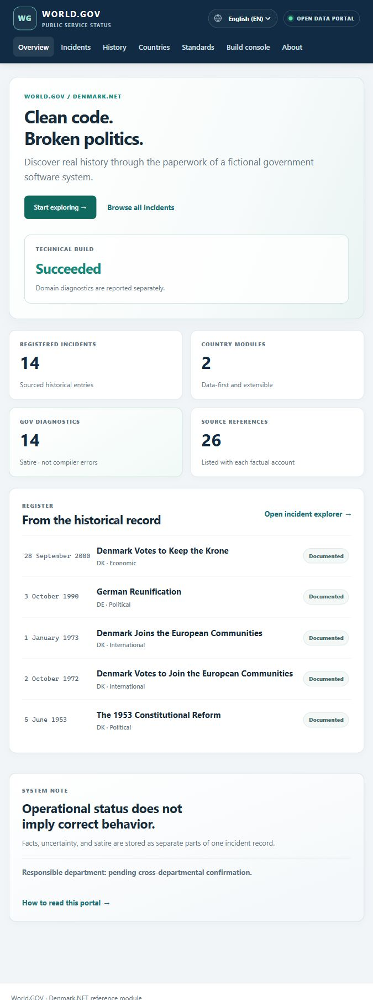

# World.GOV / Denmark.NET

**Clean Code. Broken Politics.**  
Come for the bugs. Stay for the history.

World.GOV is an open-source C# project that presents sourced historical events through an enterprise software metaphor. Each record keeps its historical account, uncertainty, sources, and fictional implementation details in separate fields. Denmark is the reference module; a data-only Germany module demonstrates the shared country contract.

Run [Start World.GOV.cmd](Start%20World.GOV.cmd) on Windows, then [try the four-event introductory tour](http://localhost:5255/start). See [local setup](#build-and-run-locally) for other platforms.

## What is implemented

- Versioned country manifests and JSON incident records.
- A content validator for schema version, country and incident identifiers, structured date precision, source IDs and HTTPS citations, GOV standards, and local or cross-country relationships.
- A shared source registry and static exporter for country data, timelines, diagnostics, standards, and an honest build report.
- A CLI for validation, export, country and incident lookup, virtual history, trace/blame, domain diagnostics, and authentic local Git history.
- A Blazor WebAssembly portal with dashboard, country index, searchable incident explorer, incident detail, Public/Developer views, history, standards, build console, and project guidance.
- A site-wide language chooser, English and Danish public-interface catalogs, Danish translations for Denmark's and Germany's incident records, and English fallback for missing text. Developer view, code, simulated commits, diagnostics, build output, and GOV standards stay English.
- Fictional archive memos with reversible redactions, starting with REGAN Vest: reveal the full text or restore the black bars while the historical account and sources remain visible.
- GitHub Actions for build, content validation, static export, web publish, and GitHub Pages deployment from `main`.

Selected Danish records now include the Jelling stones with their uncertain dating, constitutional milestones, the 1920 reunification, the disputed legacy of the 1933 Kanslergade Agreement, occupation and liberation history, and the later formation of postwar memory. Cold War entries cover Denmark's NATO founding treaty, the 1962 civil-defence leaflet, the REGAN Vest government bunker, and the 1982–1988 footnote policy. The collection also covers Denmark's European integration and euro referenda. A four-event introductory tour remains curated separately from the expanding timeline. Germany covers the occupation of Denmark, the 1949 Basic Law, 1990 reunification, and the 2020 opening of Berlin Brandenburg Airport, with local standards for provisional configuration and project scheduling. This is a growing historical collection, not an exhaustive national archive.

## Requirements

- .NET 10 SDK
- Git for authentic `real-history` and `real-blame` commands

## Build and run locally

On Windows, double-click **Start World.GOV.cmd**. It builds, validates and exports the content, then serves the portal at http://localhost:5255. Keep the terminal open while browsing. Start with the introductory tour; Public view includes a fictional administrative memo, and Developer view reveals the diagnostics and code.

If World.GOV is already running on that port, the launcher opens the existing portal. Stop its original terminal with Ctrl+C before launching again to rebuild changes. If another program owns the port, the launcher reports that before building; choose a different port with `powershell -NoProfile -File scripts/Start-Portal.ps1 -Port 5256`.

From the repository root:

    dotnet restore World.GOV.sln
    dotnet build World.GOV.sln --configuration Release
    dotnet test World.GOV.sln --configuration Release --no-build
    dotnet run --project src/World.GOV.Cli -- validate
    dotnet run --project src/World.GOV.Cli -- export --output src/World.GOV.Web/wwwroot/data --build-status succeeded
    dotnet run --project src/World.GOV.Web

Only pass `--build-status succeeded` after the build command has succeeded. Without a supplied build result, the exported report says `Not reported`. The web app is static Blazor WebAssembly; it does not require a hosted application server after publication.

## CLI

Run a command from the repository root with `dotnet run --project src/World.GOV.Cli -- <command>`.

    countries list
    incident show DK-1849-001
    incident show DK-1849-001 --view developer
    history DK
    trace DK-1915-001
    diagnostics DK
    standards list
    translations status
    validate
    export --output publish-data
    real-history
    real-blame countries/denmark/incidents/DK-1849-001.json

Virtual history IDs use the `SIM-` prefix and are explicitly fictional. `history --include-classified` prints a fictional redaction notice and does not access or claim to reveal classified information. Domain diagnostics never determine the technical build exit code.

## Data contract

Each `countries/<slug>/country.json` manifest lists its supported locales and relative incident and standard files. Each country also has a `sources.json` registry. Incidents store one or more `countryIds`, a structured date with calendar, precision, optional range, and display text, plus stable source IDs. Every published incident needs a factual summary, evidence status, and at least one registered HTTPS source. Related records use a typed link with an incident ID and a short label. The validator resolves source, standard, and cross-country incident references. It validates URL structure, but a maintainer must still review source reachability and historical accuracy.

Run the validator before exporting. Exported files are sorted and normalized; the manifest timestamp can be fixed with `SOURCE_DATE_EPOCH`. A data timestamp is included in browser requests to refresh the published JSON after each export. The project does not claim that a URL is reachable just because it is well formed; sources still need human review.

## Contribute a translation

English is the default and the complete source language. English and Danish are maintained; other languages can be contributed in small pull requests. Create a blank website language file with `dotnet run --project src/World.GOV.Cli -- translations new de-DE --name Deutsch --english-name German`, fill in any values, and run `validate`. Missing entries use English automatically. Read [the translation guide](docs/contributing/translations.md) for public incident translations, formatting slots, previews, and the English-only developer boundary. The About page shows website translation progress.

## GitHub Pages

The deployment workflow runs on pushes to `main`. In the repository settings, select **GitHub Actions** as the Pages build source. The workflow builds and validates the reviewed source, exports JSON, publishes Blazor WebAssembly, sets the repository base path, and adds a `404.html` SPA fallback. Pull request workflows have read-only repository permissions and do not deploy.

## Project map

- `src/World.GOV.Core` — shared domain and publication contracts
- [src/Denmark.NET](src/Denmark.NET/README.md) — compile-time reference country module with executable fictional policies and satirical regression tests
- `src/World.GOV.Tooling` — content loading, validation, diagnostics, and export
- `src/World.GOV.Cli` — command-line history, trace, diagnostics, and content tools
- `src/World.GOV.Web` — static Blazor WebAssembly portal
- `countries` — country manifests, incidents, and GOV standards
- `schemas` — JSON Schema documents for version 1 country and incident records
- `docs` — GDD and architecture/contributor notes

## Engineering limits

Technical build failures remain real. GOV diagnostics are satire and are exported separately. The site has no backend, visitor code execution, login, or live government-system access. The regression suite covers the content and export pipeline, portal data loading, shared-country records, available translations, and rendered timeline ordering. A Roslyn analyzer, country maps, and additional translations are optional future extensions.

## Release and contributions

Run `powershell -NoProfile -ExecutionPolicy Bypass -File scripts/Publish-Release.ps1` to restore, build, test, validate, export, and package a static site under `.artifacts/releases`. The execution-policy option applies to that process only. Each failure stops the release. The ZIP is for an HTTP static host; opening its HTML directly from disk does not run WebAssembly correctly.

Use this **World.GOV folder as the Git repository root**, including `.github`. The Pages workflow tests and builds with read permissions; a separate deployment job receives publishing permissions. Enable Pages with GitHub Actions and protect `main` before accepting community changes. A published build report describes that publication's build, not later failed workflow attempts.

Start a new country by copying the two folders described in [the contributor starter](templates/README.md). Read [editorial policy](docs/editorial-policy.md), [governance](GOVERNANCE.md), and [release notes](CHANGELOG.md). Original code and writing are licensed under [MIT](LICENSE); external sources retain their own terms. The original GDD remains a design reference; the changelog and these docs describe the implemented release.

See [`docs/World.GOV_GDD_v0.3_EN.md`](docs/World.GOV_GDD_v0.3_EN.md) for the full design baseline.
