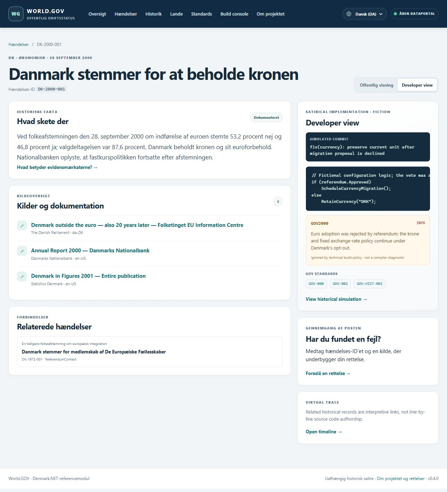

# Contributing translations

English is the project's default language and the source for every translation. The maintainer supports English and Danish. Other languages are community contributions, reviewed through ordinary pull requests; there is no promise that the maintainer can translate or verify them.

## What can be translated

- Public website navigation, filters, instructions, accessibility labels, evidence explanations, and project information: `locales/<locale>.json`.
- Historical titles, factual summaries, uncertainty notes, relationship labels, and public administrative memos: the incident's existing `translations` object in `countries/<country>/incidents/<id>.json`.

The following always stay in English: **Developer view**, **SATIRICAL IMPLEMENTATION · FICTION**, code and comments, simulated commits, diagnostic messages and severities, build/terminal output, technical status panels, and GOV standards. Brand names, incident IDs, country IDs, JSON property names, source IDs, routes, and filenames stay unchanged. Keep source titles in their original language.



The old v1 `translations.commitMessage` and `translations.diagnosticMessage` fields are retained for compatibility, but the website ignores them. Do not add or translate those fields. Public memos have their own `publicSummary` field.

## Add a website language

From the repository root, for example:

```text
dotnet run --project src/World.GOV.Cli -- translations new de-DE --name Deutsch --english-name German
```

This creates `locales/de-DE.json` with the English text as keys and blank translation values. It refuses to overwrite an existing file. Fill in any number of values; leave the rest blank or omit them. Missing and blank entries fall back to the English source text. A language appears in the chooser after it has at least one nonblank website translation or a published incident translation. A new language does not require a country module or C# changes.

For a language written right to left, add `--direction rtl`. Public interface containers follow that direction; developer and compiler output retain `lang="en"` and `dir="ltr"`.

If you cannot run .NET, copy `locales/en-US.json`, rename the copy to your language code, replace the locale/name metadata, and clear values you have not translated. You can submit the file through GitHub's editor; CI runs validation on the pull request.

An example of a partial contribution:

```json
{
  "schemaVersion": 1,
  "locale": "de-DE",
  "nativeName": "Deutsch",
  "englishName": "German",
  "direction": "ltr",
  "strings": {
    "Overview": "Übersicht",
    "Countries": "Länder",
    "Page {0} of {1}": "Seite {0} von {1}"
  }
}
```

This is a format example, not a maintained German translation. Use English keys exactly as listed in `locales/en-US.json`. Translating the value never changes the English original. Formatting slots such as `{0}` and `{1}` must all remain; their order may change. Values are plain text, rendered with normal HTML escaping. Do not add HTML or JavaScript.

Check progress and validate:

```text
dotnet run --project src/World.GOV.Cli -- translations status
dotnet run --project src/World.GOV.Cli -- validate
dotnet test World.GOV.sln
```

Then run the local launcher to preview, choose your language, and inspect a page with an untranslated incident. Check that English fallback reads clearly and Developer view stays English. Submit the language file in a pull request, describe what you translated, and state whether a fluent speaker reviewed it. Partial contributions are welcome.

## Translate an incident

Add or update `translations["<locale>"]` in the original incident file. Translate only the public fields you can review: `title`, `category`, `evidenceStatus`, `historicalSummary`, `historicalUncertainty`, `publicSummary`, and `relationLabels`. Category and evidence labels normally come from the website catalog, so individual overrides are optional. Relation-label keys are the existing related incident IDs.

Keep the English top-level fields, source references, evidence classification, date precision, and uncertainty intact. A translation must not strengthen a claim, remove a caveat, invent a quote, or change an interpretation. Omit a field when its translation is not ready; the website uses the English value. Do not place translations under `en-US`: the original English fields are authoritative and any such incident override is ignored.

For an incident with a fictional `satire.archive`, you can also add `translations["<locale>"].archive`. Copy the whole archive object and translate its `title`, line `label` values, and line `text` values. Translate optional `classifiedMessage`, `declassifiedMessage`, and `reclassifiedMessage` values too; missing message translations use the English text. The CLASSIFIED / DECLASSIFIED / RECLASSIFIED stamps stay English. Preserve its `SIM-ARCHIVE-` ID, line order, and `redacted` booleans. Omit the entire translated archive until it is ready; it falls back to the English memo. See [REGAN Vest](../../countries/denmark/incidents/DK-1963-001.json) for an English/Danish example. Full memo text is public site data, including lines initially shown as black bars.

## Updating English interface text

Website code calls `T("English source text")`. Add the identical key and value to `locales/en-US.json` when introducing a new public label. Tests require every literal call to exist in that baseline. Dynamic category/evidence/region keys also belong in the baseline. When English wording changes, update the English key and value. Old community entries are reported as unused warnings and ignored; the new wording falls back to English immediately. Publishing an English change does not require translating or cleaning up every other language first. Contributors can remove or re-review outdated entries later.

CI checks JSON shape, locale filenames, English baseline values, and formatting slots for active translations. Unknown keys are warnings, so check them for typos when contributing. Only active keys count toward coverage. CI cannot verify translation quality or historical accuracy. The About page shows website-string coverage; this does not claim that every incident is translated.
